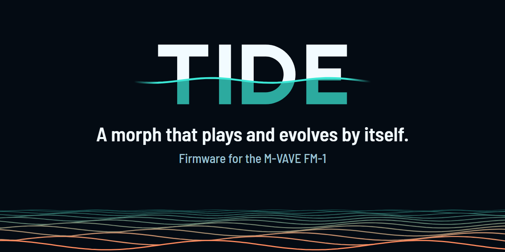

# TIDE for FM-1

A morph that plays and evolves by itself. Firmware for the M-VAVE FM-1.

TIDE for FM-1 by pssdrnk. Built on DUELL (OSCILL/R) and Felucca (Hügelton Instruments). GPL-3.0. Not made or endorsed by OSCILL/R or M-VAVE.

[Install](#install) · [Try it in the browser](https://pssdrnk-cmyk.github.io/DUELL-TIDE/emu/) · [Play it](docs/TIDE_GUIDE.md) · [All documents](docs/DOCS_INDEX.md) · [Issues](https://github.com/pssdrnk-cmyk/DUELL-TIDE/issues)

## What TIDE is

- DUELL's MORPH glides a sound between two versions of itself, End A and End B, with one fader. **TIDE moves that fader for you**, in time with the music, each trip a little different, like a tide between two shores.
- It is made for playing the FM-1 as a **background**: set a tide going, then play your drum machine, bass or sampler over it. A hand on the knob can take over at any time.
- Eighteen factory multis, six STYLE presets (DUB, DEEP, MINIMAL, AMBIENT, PEAK, DRONE), a live view of the sound as waves.

| AUTO TIDE | TIDE SETTINGS | MORPH, mid-glide |
|:---:|:---:|:---:|
|  |  |  |
| The glide, both parts, with their steps. | STYLE on top, then how the tide behaves. | The MORPH page follows the glide. |

*Screens rendered from the firmware's own drawing code; try them live in the [web emulator](https://pssdrnk-cmyk.github.io/DUELL-TIDE/emu/).*

## Start in 30 seconds

1. Press **HOME** until **AUTO TIDE** shows (HOME's round is MORPH, TIDE SETTINGS, AUTO TIDE).
2. Twist **knob 1** right (to B) and press **PLAY**. The glide starts on the next bar.
3. Play over it. **STOP** pauses the glide; PLAY goes on from there.

A fresh unit comes up ready: multi **M02 DUB CHORD**, AUTO TIDE on EVOLVE, both parts, 16 bars. The whole guide is [docs/TIDE_GUIDE.md](docs/TIDE_GUIDE.md).

## Install

**Stable: [`stable-2026-11-03`](https://github.com/pssdrnk-cmyk/DUELL-TIDE/tree/stable)** (played and validated on the fork owner's unit) · **Beta: [`1.0.0-b9`](https://github.com/pssdrnk-cmyk/DUELL-TIDE/releases/tag/tide-1.0.0-b9)** (under test). [Which is which, and building it yourself](docs/BUILDS.md).

Use the **installer page** (Chrome or Edge): <https://pssdrnk-cmyk.github.io/DUELL-TIDE/install/>. It offers both channels, saves a backup of the unit first, then writes the package. Use a **data** USB cable straight into the computer (no hub). Steps, the checklist and the way back: [docs/INSTALL.md](docs/INSTALL.md).

> **Use at your own risk.** TIDE has run on **one FM-1, the fork owner's**. The FM-1 has a single copy of its firmware and no known rollback; a failed write can leave it dark, and then only a hardware recovery helps ([docs/RECOVERY.md](docs/RECOVERY.md)). [Back up first](docs/RECOVERY.md). No warranty.

> **TIDE is by pssdrnk, not by OSCILL/R.** The links on OSCILL/R's site (installer, emulator, editor, releases) install and show plain DUELL, not TIDE. Please send TIDE problems to this fork's [issues](https://github.com/pssdrnk-cmyk/DUELL-TIDE/issues), not to the DUELL author.

## Read more

| I want to... | Read |
|---|---|
| Install or update | [docs/INSTALL.md](docs/INSTALL.md) |
| Play it | [docs/QUICKSTART.md](docs/QUICKSTART.md), [docs/TIDE_GUIDE.md](docs/TIDE_GUIDE.md), [docs/TIDE_QUICK_TABLE.md](docs/TIDE_QUICK_TABLE.md) |
| Fix a problem or recover | [docs/TROUBLESHOOTING.md](docs/TROUBLESHOOTING.md), [docs/RECOVERY.md](docs/RECOVERY.md) |
| Know the limits | [docs/KNOWN_LIMITS.md](docs/KNOWN_LIMITS.md), [docs/KNOWN_ISSUES.md](docs/KNOWN_ISSUES.md) |
| See what changed | [CHANGELOG-TIDE.md](CHANGELOG-TIDE.md), [what TIDE changes from DUELL 1.1](docs/WHAT_CHANGED.md) |
| Know all the builds | [docs/BUILDS.md](docs/BUILDS.md) |
| Read the full design | [SPEC.md](SPEC.md) |
| Find any other document | [docs/DOCS_INDEX.md](docs/DOCS_INDEX.md) |
| Help build it | [CONTRIBUTING.md](CONTRIBUTING.md), [SECURITY.md](SECURITY.md), [docs/TESTING.md](docs/TESTING.md) |
| Report a bug | TIDE: this fork's [issues](https://github.com/pssdrnk-cmyk/DUELL-TIDE/issues/new/choose). Plain DUELL: OSCILL/R's [bug report form](https://github.com/oscillr/DUELL/issues/new/choose) |

## Credits and licence

TIDE for FM-1 by pssdrnk. Built on **DUELL** by OSCILL/R, which is a fork of **Felucca** by Leo Kuroshita (@kurogedelic), Hügelton Instruments. Licensed under the **GPL-3.0-only** ([LICENSE](LICENSE)). The full list of thanks and third-party parts: [CREDITS.md](CREDITS.md), [NOTICE.md](NOTICE.md), [felucca-base/LICENSING.md](felucca-base/LICENSING.md); the upstream commit is in [UPSTREAM_COMMIT.txt](UPSTREAM_COMMIT.txt). The DUELL logo and artwork are OSCILL/R's work and not under the GPL; they are not used here. TIDE is not affiliated with OSCILL/R or M-VAVE.
