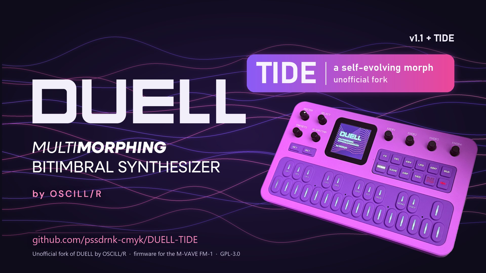
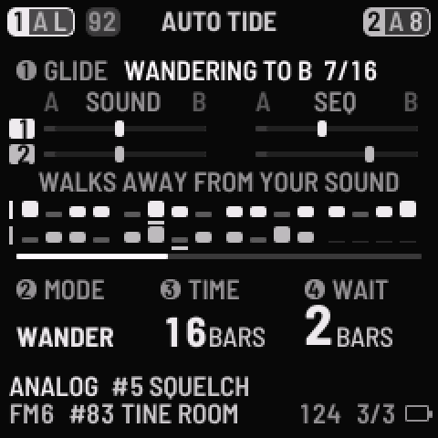
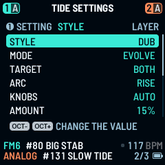
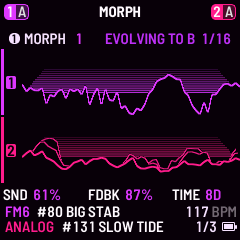

# DUELL with TIDE

**DUELL 1.1 for the M-VAVE FM-1, plus TIDE: a morph that plays and evolves by itself.**

**Stable: [`stable-2026-11-03`](https://github.com/pssdrnk-cmyk/DUELL-TIDE/tree/stable) · Beta: [`beta-2026-11-04`](https://github.com/pssdrnk-cmyk/DUELL-TIDE/tree/beta-2026-11-04)** ([what that means](#builds-stable-and-beta))

[Try it in the browser](https://pssdrnk-cmyk.github.io/DUELL-TIDE/emu/) · [What changed](#what-changed-from-duell-11) · [Install](#install) · [All documents](docs/DOCS_INDEX.md) · [Issues](https://github.com/pssdrnk-cmyk/DUELL-TIDE/issues)

## The idea

DUELL's MORPH glides a sound between two versions of itself, End A and End B, with one fader. **TIDE moves that fader for you**, in time with the music: from A to B and back, each trip a little different, like a tide between two shores. The pattern can glide with the sound.

It is made for playing the FM-1 as a **background**: set a tide going, then play your drum machine, bass or sampler over it. Nothing has to be managed live, and a hand on the knob can still take over at any time.

## What it looks like

| AUTO TIDE | TIDE SETTINGS | MORPH, mid-glide |
|:---:|:---:|:---:|
|  |  |  |
| The glide, both parts, with their steps. | STYLE on top, then how the tide behaves. | DUELL's MORPH page follows the glide. |

*Screens rendered from the firmware's own drawing code; try them live in the [web emulator](https://pssdrnk-cmyk.github.io/DUELL-TIDE/emu/).*

## Play a tide in four steps

1. Press **HOME** until **AUTO TIDE** shows. HOME's round is now **MORPH → TIDE SETTINGS → AUTO TIDE → MODE**.
2. Pick a **MODE** with knob 2, a trip length (**TIME**, in bars) with knob 3 and a rest at each end (**WAIT**) with knob 4. Turn **ALGORITHM** to BOTH to glide both parts at once.
3. Twist **knob 1** right (to B) or left (to A) and press **PLAY**. While the music plays, the glide starts on the next bar.
4. Play over it. **STOP** pauses the glide and PLAY goes on from there. Twist knob 1 two detents while it glides and it stops where it is; the sound stays.

On the very first start TIDE comes up ready: multi **M04 DUB CHORD**, AUTO TIDE on **JRNY**, both parts, 16 bars, WAIT 2. Just press PLAY.

## Before you flash

> **TIDE is by pssdrnk, not by OSCILL/R.** DUELL with TIDE is pssdrnk's fork of [DUELL](https://github.com/oscillr/DUELL) 1.1, which is made by **OSCILL/R**. The fork is not made, affiliated with or endorsed by OSCILL/R or M-VAVE. Please don't send TIDE problems to the DUELL author: use this fork's [issues](https://github.com/pssdrnk-cmyk/DUELL-TIDE/issues). DUELL and its credit belong to OSCILL/R; the code stays GPL-3.0-only.

> **Use at your own risk.** TIDE has run on **one FM-1, the fork owner's**. It has releases (stable and beta, below) but no wide testing. The FM-1 has a single copy of its firmware and no known rollback; a failed write can leave it dark, and then only a hardware recovery helps ([docs/RECOVERY.md](docs/RECOVERY.md)). Back up first. No warranty.

## Install

Two ways to put TIDE on an FM-1. Either way, [back up first](docs/RECOVERY.md) and use a **data** USB cable straight into the computer (no hub). The links on OSCILL/R's site (installer, emulator, editor, releases) install and show **plain DUELL**, not TIDE. To try TIDE without a unit, use [this fork's emulator](https://pssdrnk-cmyk.github.io/DUELL-TIDE/emu/).

**1. The installer page** (Chrome or Edge): <https://pssdrnk-cmyk.github.io/DUELL-TIDE/install/>. It offers the **Stable** and the **Beta** channel, taken from this fork's [GitHub releases](https://github.com/pssdrnk-cmyk/DUELL-TIDE/releases), saves a backup of the unit first, then writes the package. Steps, the checklist and the way back: [docs/INSTALL.md](docs/INSTALL.md).

**2. Build it yourself:**
1. Pick the build: `git checkout stable` for the validated one, or stay on `jam11` for the beta ([Builds](#builds-stable-and-beta)).
2. Build the package as in [felucca-base/BUILDING.md](felucca-base/BUILDING.md): `python3 tools/build.py` in `felucca-base`. TIDE is on by default. The result is `felucca-base/build/duell-1.1.fwsc`.
3. Install it with `python3 ../jam/jam_dev.py flash build/duell-1.1.fwsc` (needs `pip install mido python-rtmidi`). It saves a backup of the unit first, then writes the package with `tools/fm1_install.py`. Keep the computer awake.

While it writes, the unit shows the update screen (WRITING, a percent number, DO NOT SWITCH OFF). Don't unplug until the installer says it is done, then switch the unit off and on once.

TIDE keeps the version string DUELL 1.1 so every stock tool takes the unit for DUELL; the AUTO TIDE page in HOME's round shows that TIDE is on the unit, and the installer, the editor and `jam_dev.py info` read a TIDE flag in its INFO and say "with TIDE".

**The way back:** install the original DUELL 1.1 package from [OSCILL/R's releases](https://github.com/oscillr/DUELL/releases) the same way (or with their installer page), or return to M-VAVE's official firmware (V15) as in [docs/INSTALL.md](docs/INSTALL.md). Your backup restores with `jam_dev.py restore` or the editor's Backup page.

**Branches.** `jam11` is the development line (the name is the project's old code name). `stable` is the build the fork owner has validated; the tags `stable-2026-11-03` and `beta-2026-11-04` mark the published builds. `main` is meant to mirror OSCILL/R's DUELL, the base of a pull request that belongs to plain DUELL, and carries no TIDE.

## Builds: stable and beta

| Channel | Build | Date | Status |
|---|---|---|---|
| **Stable** | [`stable-2026-11-03`](https://github.com/pssdrnk-cmyk/DUELL-TIDE/tree/stable-2026-11-03) (`187e9d0`), branch [`stable`](https://github.com/pssdrnk-cmyk/DUELL-TIDE/tree/stable) | 2026-11-03 | **Tested and validated** on the fork owner's FM-1. Build this one unless you want to help test. |
| **Beta** | [`beta-2026-11-04`](https://github.com/pssdrnk-cmyk/DUELL-TIDE/tree/beta-2026-11-04) (`77a6df2`), on branch `jam11` | 2026-11-04 | **Under test.** Adds STYLE, ARC, SYNC, TURNS LEAD / ECHO, POLY, the USER slots, 32 more sounds, new patterns and multi sequences, list previews, JRNY role families and live graphs. Known issues in this build: the SAVE > MULTIS page layout, the TIDE page step bars not always matching what plays, and a latched arp playing on after STOP (use STOP ALL). All three are fixed on `jam11` for the next beta. |

`jam11` (this page) is the development line: everything on this page describes the **beta**. A build becomes stable only after the fork owner has played and validated it on the unit. To build the stable one, check out the `stable` branch first (see [Install](#install)).

## What changed from DUELL 1.1

**AUTO TIDE** runs the tide: knob 1 glides to B or to A, knob 2 picks the MODE (ONCE, LOOP, DRIFT, WNDR, JRNY), knob 3 the TIME of a trip (1 to 64 bars), knob 4 the WAIT at each end, and ALGORITHM picks PART 1, PART 2 or BOTH. **TIDE SETTINGS** says how it behaves: STYLE, TARGET, VARY BARS, ROLL, ROLL ARP, ROLL PITCH, WASH, TURNS, POLY, SYNC and ARC. Every row, its values and when a change lands are in the [TIDE guide](docs/TIDE_GUIDE.md). The STYLE presets:

| STYLE | MODE | TIME | WAIT | VARY BARS | TURNS | POLY | SYNC | ARC | WASH |
|---|---|---|---|---|---|---|---|---|---|
| **DUB** | JRNY | 16 bars | 2 bars | EVERY 4TH | LEAD | GENTLE | SOFT | RISE | OFF |
| **DEEP** | WNDR | 32 bars | 4 bars | EVERY 4TH | TAKE TURNS | OFF | SOFT | RISE | LOW |
| **MINIMAL** | WNDR | 8 bars | OFF | EVERY BAR | LEAD | WIDE | PUSH | OFF | OFF |
| **AMBIENT** | JRNY | 64 bars | 8 bars | EVERY 4TH | TOGETHER | GENTLE | OFF | OFF | HIGH |
| **PEAK** | JRNY | 8 bars | OFF | EVERY BAR | LEAD | GENTLE | PUSH | DROP | OFF |

A new unit starts on DUB, so DUB's row (bold) is the default. A unit that had TIDE settings saved before STYLE existed keeps them and shows CUSTOM; the rows it lacked load as TURNS TAKE TURNS, POLY GENTLE, SYNC SOFT and ARC OFF.

Also new: 35 more factory sounds (#129 to #163, three of them FM6) and ten chord and pad patterns for dub techno and deep house; four USER slots for patches (U1 to U4) and for patterns (P29 to P32); MULTIS and PATTERNS lists with a preview of the picked entry; live graphs on the ENV, LFO, CYCLE, filter, INSERT, MATRIX and CHORD pages; SEQ MORPH (a pattern has an End A and an End B too); ARP SEQ on PLAY; KEEP in the SEQ tools. Fixes that also hold with TIDE off (clock phase, FM6, UNISON, PHYS, CHORD keys, MODE / SPLIT) are in the [CHANGELOG](CHANGELOG.md). To make room, the fonts are Huffman-coded and UI render paths no page reaches are gone; building with `DUELL_TIDE=0` gives DUELL 1.1 without any TIDE code, and `jam/check_off.sh` checks that.

DUELL 1.1 itself (the parts and modes, the ten engines, the factory content, effects, MIDI and the CC map) is in the [DUELL 1.1 reference](docs/DUELL_1_1_REFERENCE.md).

## Build and test

Building a device image is described in [felucca-base/BUILDING.md](felucca-base/BUILDING.md); a normal build has the two-core firmware and the update screen. Host tests: `./host_tests.sh` on Linux or macOS, `sh jam/check.sh` in Git Bash on Windows (see [docs/TESTING.md](docs/TESTING.md) and [CONTRIBUTING.md](CONTRIBUTING.md)).

## Read more

| I want to... | Read |
|---|---|
| Install or update | [docs/INSTALL.md](docs/INSTALL.md) |
| Play it | [docs/QUICKSTART.md](docs/QUICKSTART.md) |
| Play TIDE | [docs/TIDE_GUIDE.md](docs/TIDE_GUIDE.md) |
| Fix a problem | [docs/TROUBLESHOOTING.md](docs/TROUBLESHOOTING.md) |
| Recover from a failed flash | [docs/RECOVERY.md](docs/RECOVERY.md) |
| Know the limits | [docs/KNOWN_LIMITS.md](docs/KNOWN_LIMITS.md), [docs/KNOWN_ISSUES.md](docs/KNOWN_ISSUES.md) |
| See what changed | [CHANGELOG-TIDE.md](CHANGELOG-TIDE.md), [RELEASE_NOTES.md](RELEASE_NOTES.md) (DUELL 1.1's own notes, by OSCILL/R) |
| Read the full design | [SPEC.md](SPEC.md) |
| Find any other document | [docs/DOCS_INDEX.md](docs/DOCS_INDEX.md) (every document, its audience and whether it is current) |
| Help build it | [CONTRIBUTING.md](CONTRIBUTING.md), [SECURITY.md](SECURITY.md) |
| Report a bug | TIDE: this fork's [issues](https://github.com/pssdrnk-cmyk/DUELL-TIDE/issues/new/choose). Plain DUELL: OSCILL/R's [bug report form](https://github.com/oscillr/DUELL/issues/new/choose) |

## Credits and licence

DUELL is a fork of **Felucca** by Leo Kuroshita (@kurogedelic), Hügelton Instruments, and is licensed under the **GPL-3.0-only** ([LICENSE](LICENSE)). The whole list of thanks and of third-party parts is in [CREDITS.md](CREDITS.md), [NOTICE.md](NOTICE.md) and [felucca-base/LICENSING.md](felucca-base/LICENSING.md); the upstream commit is in [UPSTREAM_COMMIT.txt](UPSTREAM_COMMIT.txt). The DUELL logo and artwork are the work of OSCILL/R and are not part of the GPL licence; the code and the splash graphic as shipped in the firmware are GPL-3.0-only. DUELL is an independent project and is not affiliated with M-VAVE.

DUELL with TIDE (the TIDE pages, the glide and SEQ MORPH, and the fixes listed in the [CHANGELOG](CHANGELOG-TIDE.md)) is a fork of DUELL 1.1 under the same GPL-3.0-only licence. It is not affiliated with OSCILL/R or M-VAVE.
