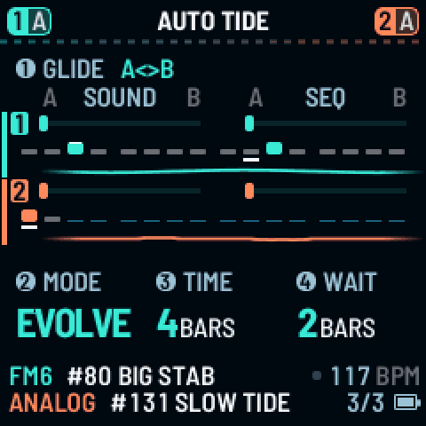
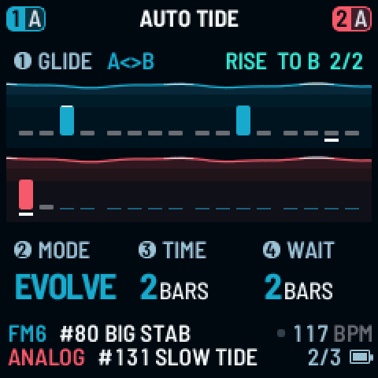
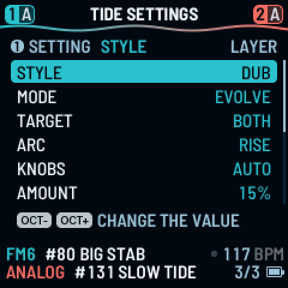
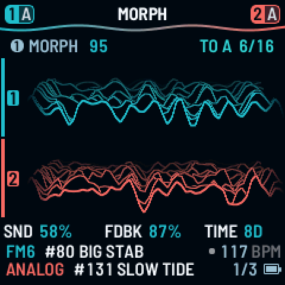
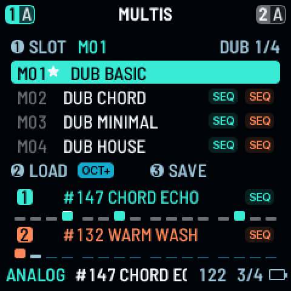
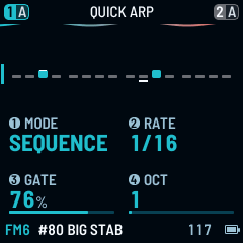
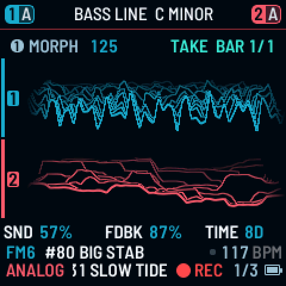
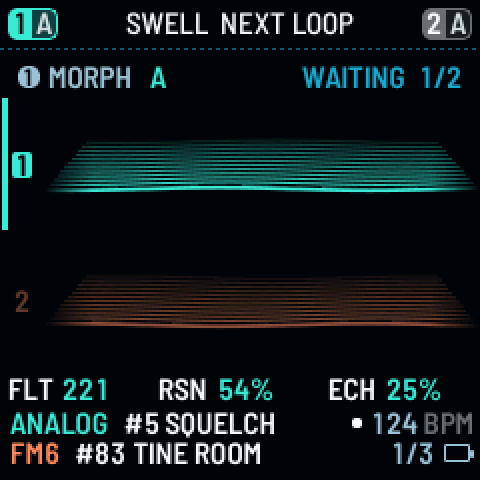
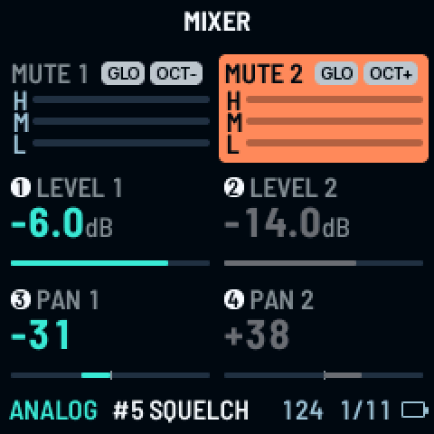
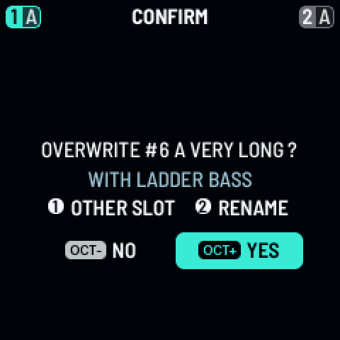

# TIDE for FM-1

A morph that plays and evolves by itself. Firmware for the M-VAVE FM-1.

TIDE for FM-1 by pssdrnk. Built on DUELL (OSCILL/R) and Felucca (Hügelton Instruments). GPL-3.0. Not made or endorsed by OSCILL/R or M-VAVE.

[Install](#install) · [Try it in the browser](https://pssdrnk-cmyk.github.io/DUELL-TIDE/emu/) · [Play it](docs/TIDE_GUIDE.md) · [All documents](docs/DOCS_INDEX.md) · [Issues](https://github.com/pssdrnk-cmyk/DUELL-TIDE/issues)

## What TIDE is

- DUELL's MORPH glides a sound between two versions of itself, End A and End B, with one fader. **TIDE moves that fader for you**, in time with the music, each trip a little different, like a tide between two shores.
- It is made for playing the FM-1 as a **background**: set a tide going, then play your drum machine, bass or sampler over it. A hand on the knob can take over at any time.
- 26 factory multis in genre order plus a blank one for playing live (M27 EMPTY), six STYLE presets (DUB, DEEP, MINIMAL, AMBIENT, PEAK, DRONE), a live view of the sound as waves.

<em>AUTO TIDE during one glide to B and back, recorded from the firmware running in the emulator (TIME 2 bars so a round trip fits in a few seconds).</em>

## Start in 30 seconds

1. Press **HOME** until **AUTO TIDE** shows (HOME's round is MORPH, AUTO TIDE, TIDE SETTINGS; HOME opens MORPH, so one more tap).
2. Twist **knob 1** right (to B) and press **PLAY**. The glide starts on the next bar.
3. Play over it. **STOP** pauses the glide; PLAY goes on from there.

A fresh unit comes up ready: multi **M02 DUB CHORD**, AUTO TIDE on EVOLVE, both parts, 16 bars. The whole guide is [docs/TIDE_GUIDE.md](docs/TIDE_GUIDE.md).

## How it works

Each block says what a function does for you and which control to use. The pictures are the unit's own screen, rendered from the firmware (release candidate `rc13`). The details of every row are in the [TIDE guide](docs/TIDE_GUIDE.md).

### AUTO TIDE: the glide

AUTO TIDE moves the sound and the pattern from A to B and back, bar by bar, while the music plays. It is the page you live on, and it looks like a tide.
- **What you see:** each part's steps stand in water, part 1 in sea glass above and part 2 in coral below. The water is **low at A and high at B** and rises and falls as the glide goes. While the tide waits at an end (WAIT) the water rolls slowly in moonlight; armed (waiting for PLAY) it holds still, dashed; stopped it holds still and dim. A take that is recording turns it red.
- **Knob 1 (GLIDE):** twist right to go to B, left to go to A. It starts on the next bar. Twist two detents again while it runs and it stops where it is. Its line says where the trip is, for example `RISE  TO B 2/16`.
- **PLAY and STOP:** the glide only moves while the transport plays. STOP pauses it; PLAY carries on from there.
- **Knob 2 MODE:** EVOLVE walks your own sounds; TRAVEL hops through factory sounds of the same kind. **Knob 3 TIME:** bars per trip, 1 to 64. **Knob 4 WAIT:** bars to rest at each end, OFF to 16.
- Hold **OCT-** and turn knob 1 to go back to your original sound and pattern.

More: [AUTO TIDE in the guide](docs/TIDE_GUIDE.md#2-auto-tide-the-page-you-live-on). 

### TIDE SETTINGS: set and forget

How the tide behaves. **Knob 1** picks a row, **OCT+** and **OCT-** change its value (knobs 2 to 4 turn it too). A value that does nothing in the present setup is dim. The rows:
- **STYLE:** one pick for the whole feel: DUB, DEEP, MINIMAL, AMBIENT, PEAK or DRONE. It sets MODE, TIME, WAIT and ARC and how the pattern varies. Changing any of those by hand makes it CUSTOM.
- **MODE:** EVOLVE or TRAVEL, the same as knob 2 on AUTO TIDE.
- **TARGET:** what the glide moves: the sound, the pattern (SEQ) or BOTH.
- **ARC:** OFF, RISE or DROP. A long shape of 8-bar phrases: the tide rises, holds a peak, eases into a breakdown and recovers (40 to 64 bars).
- **KNOBS:** which set knobs 2 to 4 play on the MORPH page: AUTO reads the first word of the multi's name (DUB, HSE, TECH, ACID, ELEC, AMB), or pick STD.
- **AMOUNT:** how far a new random End B may go (0 to 100 %, start at 15 %).
- Then **REC**, **ANSWER**, **ANSWER ON**, **PLAY MODE**, **XFADE** and **SPLIT**, covered below. Settings are saved over a power cycle.

More: [TIDE SETTINGS in the guide](docs/TIDE_GUIDE.md#3-tide-settings-set-and-forget). 

### MORPH: the hand page

HOME's first page, for your hands. **Knob 1** is the MORPH fader from A to B; knobs 2 to 4 are the macros of the loaded multi's genre (a single sound: FILTER, RESONANCE, ECHO). Most of the page shows the sound itself as waves, like an oscilloscope: a held note stands still, a chord beats.
- **Hold OCT+ and click knob 1:** End B becomes a new random roll.
- **Hold OCT- and turn a knob:** knob 1 goes back to your original sound; knobs 2 to 4 go back to the value the sound had.
- Move the fader by hand and TIDE holds only that part; 8 bars after you let go it takes the part back from where you left it. **Hold SAVE** saves the patch.

More: [MORPH in the guide](docs/TIDE_GUIDE.md#1-morph-the-hand-page). 

### Multis and parts

The FM-1 has two **parts**, each a sound with its own pattern. A **multi** holds both parts, their effects, arps, patterns, mode and morph settings. There are 26 factory multis, in genre order (dub, house, techno, acid, electro, ambient, and two drones), and a blank one after them, **M27 EMPTY**, for playing live. You can save over the factory multis.
- **Load one:** short-press **SAVE** (it opens MULTIS in LAYER), turn **knob 1** to the multi, press **OCT+**. The preview shows both parts' sounds and their first 16 steps before you load.
- **ALGORITHM** picks PART 1, both parts (the middle) or PART 2 on the HOME pages. The middle plays the mode set by the PLAY MODE row: **LAYER** (both parts on every key), **STEREO** or **DUEL** (part 1 left, part 2 right). **SPLIT** divides the keys between the parts; **XFADE** crossfades them by velocity in LAYER.

More: [the idea](docs/TIDE_GUIDE.md#the-idea) and [QUICKSTART](docs/QUICKSTART.md). 

### QUICK layers

Hold **EDIT**, **LFO**, **ENV**, **ARP** or **GLO** for a moment and the four knobs become performance controls for the selected part; the header says which layer (QUICK ARP, ...). The keys still play; let go and you are back on your page.
- **EDIT:** cutoff, resonance, filter mode, release. **LFO:** each LFO's rate and cutoff amount. **ENV:** attack, release, the filter envelope's amount and decay.
- **ARP:** mode, rate, gate, octaves.
- **GLO:** level and pan of both parts, with the meters.
- Hold **SEQ** for the sequence tools on the white keys (SWELL, RIPPLE and KEEP are below).

More: [QUICKSTART](docs/QUICKSTART.md). 

### Live assist: record a take, get an answer

Play a line, and TIDE gives the other part something that fits. Hold **SEQ** and tap **REC** to arm recording (a tap of REC disarms), press PLAY, and play: your notes go into the pattern, and the tide line under the header fills red with the loop. When the take closes, the other part gets an **ANSWER** that fits inside the loop and does not rub against your notes:
- **BASS LINE:** a bass line in the key, one chord a bar, an octave under you, in the rhythm of the multi's genre. **DOUBLE:** your notes a scale third above. **REPLY:** your first half is the call, the second half the answer. **ECHO:** your last note thrown four times, fading.
- **ANSWER ON** OTHER writes it to the other part; OFF keeps the take only. **REC** ADD adds notes to a step that already has some; REPLACE takes their place. Both are rows of TIDE SETTINGS.
- **Undo:** hold **OCT-** and turn **PRESETS**: back along the last two takes (left) or forward again (right).

More: [ANSWER and REC in the guide](docs/TIDE_GUIDE.md#3-tide-settings-set-and-forget). 

### SWELL and RIPPLE: make the answer again

Not happy with the answer? Hold **SEQ** and press **C4: SWELL** for a whole new answer, or **D4: RIPPLE** to move a few of its notes and keep its rhythm. It lands at the start of the next loop; the header says `SWELL  NEXT LOOP` until then, and a second press replaces the waiting one. Every press is one undo step: **OCT-** and a turn of **PRESETS**. **G4: KEEP** (also with SEQ held) makes what you hear the part's own, sound and pattern. 

### The mixer

**GLO** opens the mixer (hold GLO and a knob sets levels and pans from any page). **Knob 1** is LEVEL 1, **knob 2** LEVEL 2, **knob 3** PAN 1, **knob 4** PAN 2. Hold GLO and press **OCT-** / **OCT+** to mute part 1 / part 2. Each part's card carries a three-bar meter: **L**ow (under about 250 Hz), **M**id and **H**igh (over about 2.5 kHz), each with a short peak mark, so you can see where a sound sits. Loading a sound never changes your levels; a multi remembers them. 

### Saving

**Hold SAVE** on a page to save what it edits: a patch, a pattern or a multi; the dialog offers the picked slot over itself, **OCT+** says yes, **OCT-** no. A short press opens the SAVE page that fits where you are (PATTERNS from a sequencer page, otherwise MULTIS in LAYER and PATCHES in DUEL and STEREO); SELECT moves between PATCHES, PATTERNS, MULTIS and TOOLS. Saving needs the transport stopped. SAVE keeps the sound as you loaded it, not the one TRAVEL moved it to: to keep what you hear, use KEEP first. Every factory sound has its own slot and can be saved over (RESTORE brings the factory sound back); USER 1 to 4 start empty. [Back up](docs/RECOVERY.md) before you update. 

## Install

**Stable: [`stable-2026-11-03`](https://github.com/pssdrnk-cmyk/DUELL-TIDE/tree/stable)** (played and validated on the fork owner's unit) · **Beta: [`1.0.0-b9`](https://github.com/pssdrnk-cmyk/DUELL-TIDE/releases/tag/tide-1.0.0-b9)** (under test). [Which is which, and building it yourself](docs/BUILDS.md).

Use the **installer page** (Chrome or Edge): <https://pssdrnk-cmyk.github.io/DUELL-TIDE/install/>. It offers both channels, saves a backup of the unit first, then writes the package. Use a **data** USB cable straight into the computer (no hub). Steps, the checklist and the way back: [docs/INSTALL.md](docs/INSTALL.md).

> **Use at your own risk.** TIDE has run on **one FM-1, the fork owner's**. The FM-1 has a single copy of its firmware and no known rollback; a failed write can leave it dark, and then only a hardware recovery helps ([docs/RECOVERY.md](docs/RECOVERY.md)). [Back up first](docs/RECOVERY.md). No warranty.

> **TIDE is by pssdrnk, not by OSCILL/R.** The links on OSCILL/R's site (installer, emulator, editor, releases) install and show plain DUELL, not TIDE. Please send TIDE problems to this fork's [issues](https://github.com/pssdrnk-cmyk/DUELL-TIDE/issues), not to the DUELL author.

## Read more

| I want to... | Read |
|---|---|
| Install or update | [docs/INSTALL.md](docs/INSTALL.md) |
| Play it | [docs/QUICKSTART.md](docs/QUICKSTART.md), [docs/TIDE_GUIDE.md](docs/TIDE_GUIDE.md), [docs/TIDE_QUICK_TABLE.md](docs/TIDE_QUICK_TABLE.md) |
| Fix a problem or recover | [docs/TROUBLESHOOTING.md](docs/TROUBLESHOOTING.md), [docs/RECOVERY.md](docs/RECOVERY.md) |
| Know the limits | [docs/KNOWN_LIMITS.md](docs/KNOWN_LIMITS.md), [docs/KNOWN_ISSUES.md](docs/KNOWN_ISSUES.md) |
| See what changed | [CHANGELOG-TIDE.md](CHANGELOG-TIDE.md), [what TIDE changes from DUELL 1.1](docs/WHAT_CHANGED.md) |
| Know all the builds | [docs/BUILDS.md](docs/BUILDS.md) |
| Read the full design | [SPEC.md](SPEC.md) |
| Find any other document | [docs/DOCS_INDEX.md](docs/DOCS_INDEX.md) |
| Help build it | [CONTRIBUTING.md](CONTRIBUTING.md), [SECURITY.md](SECURITY.md), [docs/TESTING.md](docs/TESTING.md) |
| Report a bug | TIDE: this fork's [issues](https://github.com/pssdrnk-cmyk/DUELL-TIDE/issues/new/choose). Plain DUELL: OSCILL/R's [bug report form](https://github.com/oscillr/DUELL/issues/new/choose) |

## Credits and licence

TIDE for FM-1 by pssdrnk. Built on **DUELL** by OSCILL/R, which is a fork of **Felucca** by Leo Kuroshita (@kurogedelic), Hügelton Instruments. Licensed under the **GPL-3.0-only** ([LICENSE](LICENSE)). The full list of thanks and third-party parts: [CREDITS.md](CREDITS.md), [NOTICE.md](NOTICE.md), [felucca-base/LICENSING.md](felucca-base/LICENSING.md); the upstream commit is in [UPSTREAM_COMMIT.txt](UPSTREAM_COMMIT.txt). The DUELL logo and artwork are OSCILL/R's work and not under the GPL; they are not used here. TIDE is not affiliated with OSCILL/R or M-VAVE.
